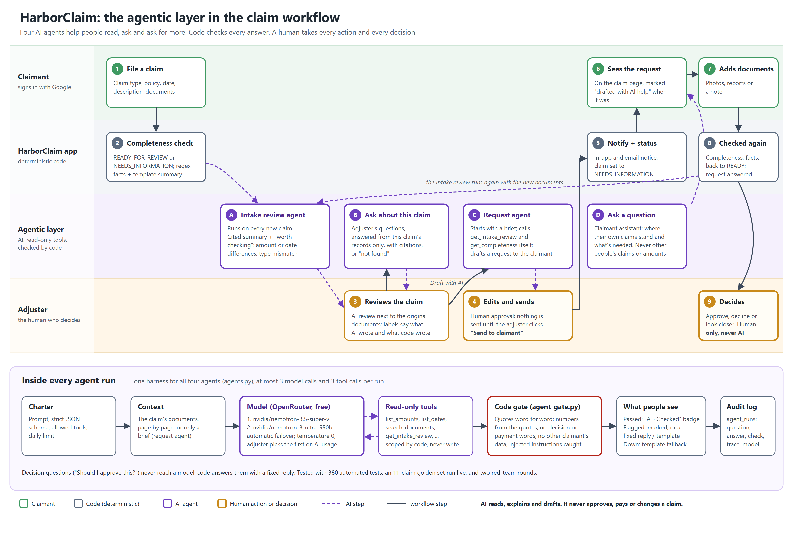

# The agentic layer in HarborClaim

*Source: [`agentic-layer.svg`](agentic-layer.svg). The full design, with every rule and its test,
is [`AGENTS.md`](AGENTS.md); the exact prompts are [`../../PROMPTS.md`](../../PROMPTS.md).*

## In one paragraph

HarborClaim takes an insurance claim from a claimant and gets it to a human adjuster with
everything needed to decide. Four AI agents sit inside that workflow. One reads every new claim
and writes a cited first review. One answers the adjuster's questions about a claim. One drafts the
request for missing information that the adjuster sends to the claimant. One answers the
claimant's own questions. They read, explain and draft. Code checks every word they write before
anyone sees it, and the one action in the loop, asking the claimant for more, is taken by the
adjuster, not the AI. Nothing an agent does can approve, pay or change a claim.

## The workflow, step by step

| Step | Who | What happens |
|---|---|---|
| 1 | Claimant | Files a claim: type, policy, incident date, description, documents. |
| 2 | Code | The completeness check marks it READY_FOR_REVIEW or NEEDS_INFORMATION; a regex scan pulls amounts and dates; a template summary is written as the fallback. |
| A | **Intake review agent** | Runs on every new claim, after the claimant's page has loaded. Writes a short summary and "worth checking" findings, e.g. *the description says $3,250.00 but the estimate totals $3,486.40*. Every sentence cites a document, page and word-for-word quote. |
| 3 | Adjuster | Reviews the AI draft next to the original documents. Everything a model wrote carries the purple `AI` badge and its check result; anything without it is the app's own. |
| B | **Ask about this claim** | The adjuster asks questions; answers come only from this claim's records, with citations, or "Not found in this claim's records." |
| C | **Request agent** | When something is missing, the adjuster clicks *Draft with AI*. The agent starts with only a brief (claim form and file names), **decides to call its tools** (`get_intake_review`, `get_completeness`, `search_documents`) to find out what's missing and what's already there, and drafts a polite request. |
| 4 | Adjuster | **Edits and sends.** Nothing is sent until the adjuster clicks *Send to claimant*. The app records whether the text came from the AI draft and whether the adjuster changed it. |
| 5 | Code | Notifies the claimant (in-app and email) and sets the claim to NEEDS_INFORMATION. |
| 6 | Claimant | Sees the request on their claim page, marked "drafted with AI help" when it was. |
| D | **Ask a question** | The claimant assistant explains where their own claims stand and what's still needed. It never mentions anyone else's claim, amounts, or a decision that isn't on record. |
| 7 | Claimant | Adds documents or a note. |
| 8 | Code | Checks the claim again; it goes back to READY_FOR_REVIEW, the request is marked answered, and **the intake review agent runs again** with the new documents. |
| 9 | Adjuster | Decides: approve, decline or look closer. Always a person; never an agent. |

## What makes it agentic

| Agent property | Where it shows |
|---|---|
| **Perceives** its environment | Reads the claim's documents page by page (intake, Ask), or fetches what it needs (request agent) |
| **Decides** which tools to use | Up to 3 tool calls per run, chosen by the model from an allowlist; every call is in the trace on the page |
| **Reasons** to a goal | A charter per agent: its job, its rules, a strict JSON output |
| **Acts** in the workflow | Drafts the request for information, which becomes a real notification and status change once a human sends it |
| **Closes the loop** | The claimant's answer triggers a fresh check and a fresh AI review, back to the adjuster |
| **Human in the loop** | The only action is approved by the adjuster; every decision is the adjuster's |

## Inside every agent run

All four agents share one harness (`agents.py`):

1. **Charter**: the prompt, a strict JSON schema, the allowed tools and a daily limit.
2. **Context**: the claim's documents, or only a brief for the request agent.
3. **Model**: free, open-weight NVIDIA models on OpenRouter, temperature 0. `nemotron-3.5-super-vl`
   first, `nemotron-3-ultra-550b` if it's busy. 12 free models were screened in 3 rounds and these
   two passed. An adjuster can choose which answers first on the AI usage page.
4. **Read-only tools**, scoped by code to one claim or one claimant, never able to write.
5. **Code gate** (`agent_gate.py`, rules G1-G9 and C): quotes must be in the documents word for
   word; every number must come from the quotes; no decision, coverage, payment or accusation
   wording; no other claimant's claim or email; instructions planted in a document are caught.
6. **What people see**: passed text gets the purple `AI` badge with "Checked"; flagged text
   is marked, or replaced by a fixed reply or the template; a model that's down leaves the
   template fallback in place.
7. **Audit log**: every run, its question, answer, check result, trace, model and timing, in the
   append-only `agent_runs` table.

Decision questions ("Should I approve this?") never reach a model: code recognises them and
answers with a fixed reply.

## When AI isn't available

The workflow never depends on AI. With AI off, a model down, or the day's limit used:

- the intake review shows the standard summary, with one line saying why there's no AI review;
- the request card offers a template draft written by code from the completeness check, and the
  adjuster sends it the same way;
- the assistants say they can't answer just now;
- filing, checking, notifying and deciding all work as before.

## Evidence it works

- **380 automated tests** with a scripted fake model (no network): every gate rule, every label,
  the request loop end to end, separation of duties, and that drafting changes nothing.
- **Golden set**: 11 fictional claims with known answers run live (`scripts/eval_agents.py`);
  used to choose the models and to keep out one that missed conflicts silently.
- **Two red-team rounds** by an independent reviewer: holes found (an obeyed injection, false type
  mismatches, dates written in words) were fixed with tests.
